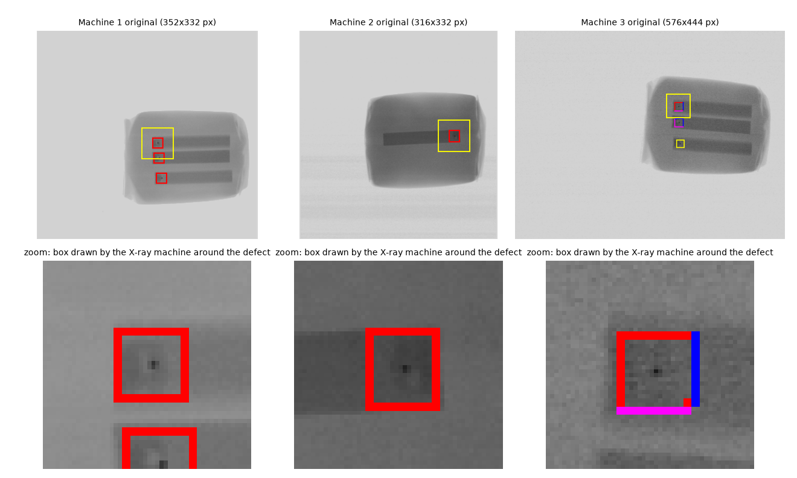
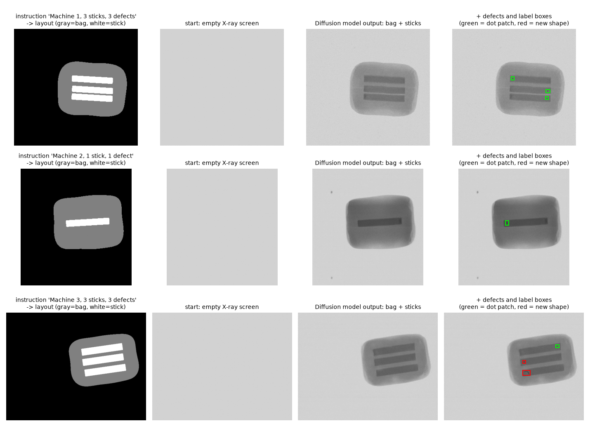
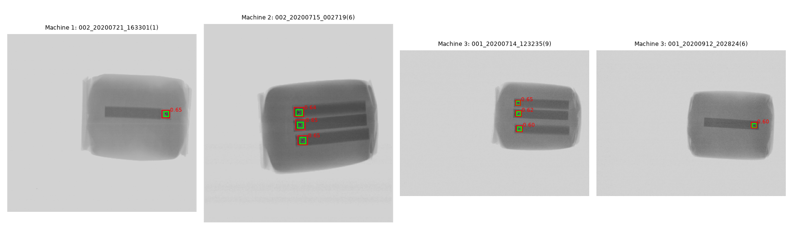

# Gen X-ray

English | [한국어](README.ko.md)

**Training an X-ray foreign-object detector on Diffusion-synthesized images only**

In this food-packaging X-ray dataset, the inspection machine has drawn a colored box around every foreign object it found, directly on the image. A detector trained on these images learns the boxes, not the 3–4 px foreign objects. Gen X-ray never trains on real images. It uses 500 human-labeled images only as material, trains a conditional Diffusion model to draw bags and sticks, inserts real defect patches and programmatically drawn shapes following X-ray attenuation, and gets the labels for free. A YOLO26s detector trained on 5,000 such synthetic images reaches **F1 0.995** on 1,870 real test images (3,194 foreign objects) that were never used for training or threshold selection.



*Raw images (top) and zoom (bottom). The small colored squares are marks drawn by the X-ray inspection machine around each foreign object; the large yellow squares only show the zoomed area.*

## Method

1. **Separate** the 500 labeled images into bag+stick images (machine marks and foreign objects erased) and 1,147 foreign-object patches stored as transmission (pixel value ÷ local background).
2. **Train a conditional Diffusion model** (U-Net, 40.77M parameters, 8,000 steps, 256×256) on the 500 bag+stick images, conditioned on a layout map (bag and stick regions) and the machine ID.
3. **Synthesize**: an instruction such as `"2호기, 스틱 3개, 이물 3개"` (machine 2, 3 sticks, 3 defects) → layout → the Diffusion model draws the bag and sticks starting from an empty screen (DDIM, 50 steps) → brightness matched to a real image → foreign objects inserted by multiplying transmission (70% real dot patches, 30% new shapes: straight, curved and bent lines, small flakes) → YOLO labels. 5,000 images, 11,548 objects.
4. **Detect and decide**: YOLO26s (COCO-pretrained) trained on 4,500 synthetic images, with early stopping and thresholds chosen on the other 500 synthetic images. Two thresholds sort each image: confidence ≥ α (0.40) → reject, β (0.05) ≤ confidence < α → re-inspect, below β → pass.



*Instruction → layout (gray = bag, white = stick) → empty screen → Diffusion output → inserted defects and labels (green = dot patch, red = new shape).*

## Results

Test set 1: 1,870 real images (3,194 foreign objects), ground truth from the inspection machine's boxes, counted at confidence ≥ α. None of these images was used for training or threshold selection.

| Model | Training data | Missed | False det. | Precision | Recall | F1 |
|---|---|---:|---:|---:|---:|---:|
| v1 black-hat filter (no training) | none (filter size and threshold tuned on the 500 labeled images) | 217 | 560 | 0.842 | 0.932 | 0.885 |
| v2 YOLO26s, real | 400 real images (marks erased) | 5 | 29 | 0.991 | 0.998 | 0.995 |
| v3 YOLO26s, synthetic 500 | 400 synthetic | 65 | 30 | 0.991 | 0.980 | 0.985 |
| v4 YOLO26s, synthetic 2,000 | 1,800 synthetic | 4 | 32 | 0.990 | 0.999 | 0.994 |
| **v5 YOLO26s, synthetic 5,000 (final)** | **4,500 synthetic** | **3** | **32** | **0.990** | **0.999** | **0.995** |

- With zero real training images, v5 matches the model trained on real images (v2) and misses fewer objects (3 vs 5). F1 by machine: 0.998 / 1.000 / 0.986. F1 at IoU 0.5 (10 px boxes): 0.992.
- Image decisions on test set 1 (every image contains foreign objects): 1,869 reject, 1 re-inspect, **0 pass**. No image with a foreign object was passed.
- Test set 2 (107 images without machine boxes): the 3 images with visible foreign objects are all rejected, and the 104 images with a cut-off or missing bag are all passed with no detection.
- 30 of the 32 false detections appear to be foreign objects the inspection machine did not mark: 23 of them are marked by the machine in another shot of the same bag taken seconds apart. So fewer false detections do not mean a better model here.



*Test set 1 examples: green = ground truth (machine-marked position), red = YOLO detection ≥ α, number = confidence.*

More figures are in [`docs/figures/`](docs/figures/).

### Limitations

- One dataset and one real defect type (3–4 px dots). The only non-dot defect in test set 1 (wire-shaped) gets confidence 0.29 from v5: below α, so the image goes to re-inspection.
- Ground truth comes from the inspection machine's marks, so objects the machine missed count as false detections.
- Each model was trained once (seed 0). The final model was chosen among v3–v5 on test set 1 with a rule fixed beforehand; v5 and v4 differ by one object.
- Synthetic noise differs from real noise: the 90th percentile of bag noise in synthetic images is 1.6–3.6× the real value, while on machine 3 the median synthetic image is smoother than real. Machine 3 also has 28 of the 32 false detections; this is not proven to be the cause.

## Repository layout

```
data/                       KAMP raw data goes here (not included, see "Data"); synthetic data from Releases
docs/figures/               report figures
models/                     v1 filter parameters, Diffusion config, YOLO training records and α·β,
                            v5 weights (models/v5_synth5000/best.pt); other weights from Releases
predictions/                v5 and comparison results as CSV/JSON (same as the competition submission)
src/                        source code: shared modules, develop/ (reproduction), release/ (generate, predict)
environment.yml, requirements.txt, requirements-lock.txt
```

Code comments are in Korean. Where they say "제출본" or "제출 폴더" they mean the competition submission, which also contained the data and weights that are distributed separately here; "README N절" refers to the sections of the detailed Korean manual [docs/manual_ko.md](docs/manual_ko.md).

## Setup

Tested on Ubuntu (aarch64) with an NVIDIA GB10 (CUDA 13.0), Python 3.11.16, torch 2.14.0+cu130, ultralytics 8.4.157, diffusers 0.40.0.

```bash
conda env create -f environment.yml      # creates the conda env "venv"
conda activate venv
```

Or install the CUDA build of torch 2.14.0 that matches your GPU, then `pip install -r requirements.txt`. `requirements-lock.txt` is the full `pip freeze` of the environment used.

## Data

The raw data is the **X-ray inspection equipment AI dataset** from KAMP (Korea AI Manufacturing Platform, https://www.kamp-ai.kr/). It is not redistributed here. Download it from KAMP and place the two folders the code reads under `data/dataset/`, keeping the original paths:

```
data/dataset/test1/yolov3/X선이물검출기(06.23_09.22)/{1,2,3}호기(2020.09.22)/<date folder>/*.bmp   (2,809 BMP)
data/dataset/라벨링 6종 세트/labels/*.txt                                                    (500 labels)
```

Then rebuild the material derived from the 500 labeled images (deterministic, about a minute):

```bash
cd src
python develop/prepare_material.py      # bag+stick images, defect patches, per-machine settings → data/material_500/
python develop/measure_shapes.py        # blur of the new shapes measured on real dots → data/material_500/shapes_500.json
```

## Release files

From the [Releases](https://github.com/sinkei9456/gen-xray/releases) page:

| File | Unzip / copy to | Contents |
|---|---|---|
| `diffusion_model.zip` | `models/` | Diffusion model (EMA weights, config, `sample.json`) |
| `yolo_v2_v3_v4_weights.zip` | `models/` | `best.pt` of v2, v3, v4 |
| `yolo26s.pt` | `models/` | COCO-pretrained YOLO26s that training starts from (the exact Ultralytics file used) |
| `synthetic_v5_5000.zip` | `data/` | the 5,000 synthetic images and labels (train 4,500 / val 500) |

## Usage

All commands run in `src/` with the environment activated.

```bash
# Generate synthetic images and labels with the Diffusion model (needs data/material_500 and diffusion_model.zip)
python release/generate.py --prompt "2호기, 스틱 3개, 이물 3개" --n 5 --out ../runs/generate
python release/generate.py --random 20 --out ../runs/generate_random

# Classify images with v5 (machine marks on raw BMPs are erased first, as in evaluation)
python release/predict.py --src "../data/dataset/test1/yolov3/X선이물검출기(06.23_09.22)/2호기(2020.09.22)" --recursive --out ../runs/predict_raw
```

**Reproduce the evaluation without training** (all release files in place): `bash develop/run_all.sh`. It skips every training and generation step whose output exists, rebuilds the test sets and ground truth from the raw data, and re-runs the evaluation of v1–v5, the comparisons and the figures. The results should match `predictions/` (on the same hardware and package versions they matched exactly). `bash develop/run_eval.sh` runs only the evaluation and comparison part (about 7 minutes on GB10); it needs the release files and `data/material_500` (see Data).

**Reproduce everything from scratch** (about 8–10 hours on GB10): do not add the release files except `yolo26s.pt`, delete `models/v5_synth5000/best.pt`, and run `bash develop/run_all.sh`. It trains the Diffusion model, synthesizes the 5,000 images, and trains and evaluates v2–v5. All seeds are fixed and training runs in deterministic mode; a full rerun from scratch on the same machine reproduced the Diffusion and YOLO weights and all results exactly. On other GPUs or versions small numerical differences can appear, and since v5 and v4 differ by one object, the final-model choice could change.

## Citation of the data

Ministry of SMEs and Startups., and KAIST (Korea Advanced Institute of Science and Technology). (2020, December 14). X-ray inspection equipment AI dataset. Korea AI Manufacturing Platform (KAMP). https://www.kamp-ai.kr/

This work was done for problem 4 of the 6th K-AI Manufacturing Data Analysis Competition (2026).

## License

AGPL-3.0 (see [LICENSE](LICENSE)), matching Ultralytics YOLO, which this code uses and whose COCO-pretrained weights the detectors were trained from. The KAMP raw data is not included and is subject to KAMP's terms.
